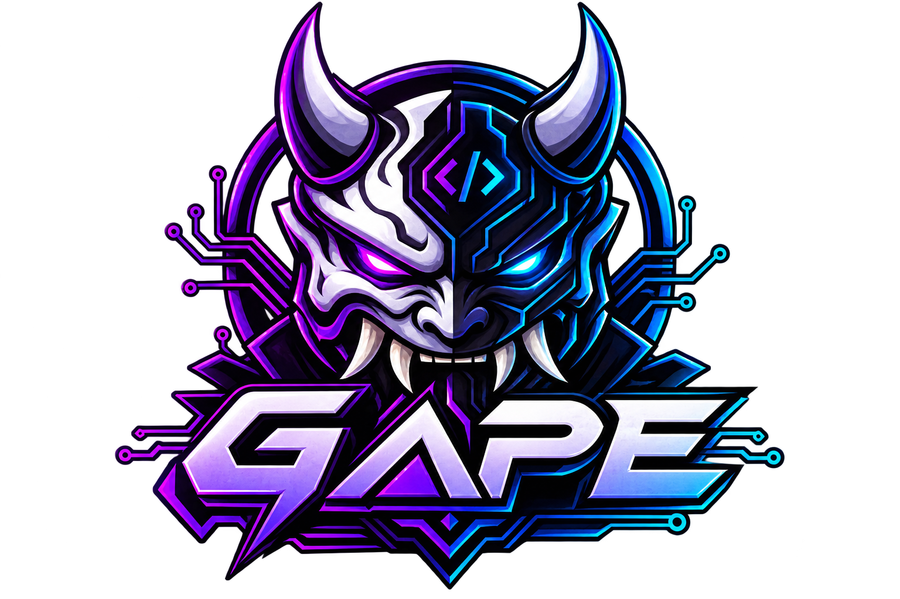

<!-- BANNER -->

# SARED GARCÍA

### DESARROLLADOR WEB JUNIOR

**Desarrollo web · Software · Proyectos personales**

---

## 👨‍💻 Sobre mí

¡Hola! Soy Sared, desarrollador web junior.

Me gusta desarrollar aplicaciones, trabajar en proyectos propios y experimentar con diferentes tecnologías. He creado proyectos que abarcan desde herramientas de gestión hasta plataformas educativas y sistemas web.

Actualmente estoy enfocado en seguir desarrollando mis habilidades, mejorar mis proyectos y aprender nuevas tecnologías.

---

## ⚡ Tecnologías y herramientas

### Frontend

### Backend y bases de datos

### Frameworks y herramientas utilizadas en proyectos

---

## 🚀 Mis proyectos

### 🧠 NeuroLearn

**Plataforma de aprendizaje educativo**

Proyecto enfocado en ayudar a estudiantes y docentes mediante evaluaciones, seguimiento académico y recomendaciones personalizadas.

---

### 📋 DocTrack

**Sistema de gestión documental**

Aplicación para administrar documentos, gestionar usuarios y facilitar los procesos de revisión, aprobación y rechazo.

---

### 🚛 RedTerrestre

**Sitio web de transporte y logística**

Proyecto web empresarial con información de servicios, presentación de la empresa y solicitudes de cotización.

---

### 💳 GestorPagos

**Control y administración de pagos**

Aplicación para organizar pagos, administrar cuotas y consultar el historial y progreso de los pendientes.

---

### ✅ TaskFlow

**Aplicación de gestión de tareas**

Sistema con frontend y backend separados, API REST y administración de tareas, estados y prioridades.

---

## 📊 Actividad en GitHub

---

### SARED × GAPE

**Código, ideas y proyectos.**

